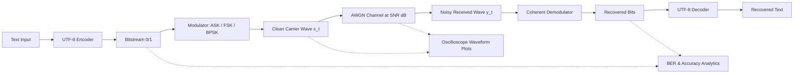

# 📡 Wireless Digital Signal Modulation and Transmission Simulator

<div align="center">

[](https://beast6713.github.io/wireless-signal-simulator/)
[](https://www.python.org/)
[](https://streamlit.io/)
[](https://github.com/whitphx/stlite)
[](tests/)
[](LICENSE)

<br/>

**A software-only academic simulation platform modeling the complete physical-layer digital wireless communication pipeline: baseband UTF-8 encoding, sinusoidal carrier modulation (ASK, FSK, BPSK), AWGN stochastic channel propagation, coherent receiver demodulation, Bit Error Rate (BER) analysis, and high-resolution oscilloscope waveform visualization.**

[**🚀 Launch Interactive Web Simulator (No Install Needed)**](https://beast6713.github.io/wireless-signal-simulator/) • [**📖 Architecture Docs**](docs/README.md) • [**⚙️ Local Setup**](#-local-installation--setup)

</div>

---

> [!NOTE]
> **Academic Notice:** This software is a purely computational, mathematical simulation running entirely in code. It does **not** transmit real physical radio frequency (RF) signals and does **not** require any physical hardware, microcontrollers, antennas, software-defined radios (SDR), or radio equipment.

---

## 🌟 Interactive Features

* **🌐 100% Serverless GitHub Hosting:** Runs client-side directly in your browser via **WebAssembly (stlite & Pyodide)**. Zero server installation, zero backend hosting fees.
* **🎨 Modern Glassmorphic Dark UI:** Futuristic aerospace telemetry aesthetics featuring Google Fonts (`Outfit`, `Inter`, `JetBrains Mono`), translucent card surfaces, glowing indicators, and live channel status meters.
* **🎯 4 Quick-Pick Simulation Presets:**
  * ⚡ **Clean BPSK:** BPSK @ 25 dB SNR (100% accuracy, zero bit errors).
  * 🌪️ **Noisy FSK:** FSK @ 10 dB SNR (moderate channel degradation).
  * ⚠️ **Extreme ASK:** ASK @ 3 dB SNR (severe amplitude noise, bit flips, and byte framing failure).
  * 🌐 **Multilingual Unicode:** Validates UTF-8 encoding with emojis and international characters (`Hello 🌍! 🛰️ Signal`).
* **🎧 Audible Carrier Waveform Synthesizer:** Listen to the synthesized audible carrier sound (10 kHz sampling) directly in your browser to hear the pitch differences in FSK, the amplitude pauses of ASK, and the phase flips of BPSK.
* **📊 Real-Time KPI Telemetry Dashboard:**
  * Instant calculation of **Transmitted Bits**, **Demodulated Bits**, **Bit Error Count**, **Bit Error Rate (BER)**, and **Accuracy (%)**.
  * Dynamic channel health indicator badge (Pristine, Moderate, or Severe Noise).
  * Side-by-side message equality cards with discrepancy identification.
* **🔬 Dark-Themed Oscilloscope Visualizations:**
  * Clean Transmitted Modulated Waveform ($s(t)$) in Electric Sky Blue (`#38bdf8`).
  * Received Channel Output with AWGN Noise ($y(t)$) in Vibrant Rose (`#f43f5e`).
  * Synchronized Dual-Trace Comparison with dashed reference overlay.
  * Digital Step Comparison Plot pinpointing individual bit flips with red cross markers (`#ef4444`).
* **🧪 74 Automated Unit Tests:** 100% passing test coverage validating every mathematical transformation, boundary condition, and edge case.

---

## 🚀 Live Web Access (GitHub Pages)

You can run and interact with the simulator immediately without installing Python or cloning the repository:

👉 **[https://beast6713.github.io/wireless-signal-simulator/](https://beast6713.github.io/wireless-signal-simulator/)**

The application executes client-side inside your browser sandbox via WebAssembly, pre-loading Python, NumPy, SciPy, and Matplotlib.

---

## 🔄 End-to-End Simulation Pipeline



1. **Baseband Encoding (`src/encoding.py`)**: Converts plaintext into UTF-8 byte arrays and expands them into serialized 8-bit binary bitstreams in Most-Significant-Bit (MSB) order.
2. **Carrier Modulation (`src/modulation.py`)**: Synthesizes time-domain sinusoidal waves sampled at $10\text{ kHz}$ with a symbol rate of $1000\text{ Baud}$ (10 samples per bit).
3. **Channel Propagation (`src/channel.py`)**: Computes signal power and injects zero-mean Gaussian distributed thermal noise scaled precisely to the user's chosen Signal-to-Noise Ratio (SNR).
4. **Coherent Demodulation (`src/demodulation.py`)**: Performs matched-filter correlation over each symbol duration to reconstruct the transmitted bits.
5. **Performance Evaluation (`src/metrics.py`)**: Compares transmitted and received bit arrays bit-by-bit to compute exact Bit Error Rate (BER) and accuracy percentages.
6. **Waveform Plotting (`src/visualization.py`)**: Generates high-resolution Matplotlib figures displayed across dedicated dashboard tabs.

---

## 📐 Mathematical Foundations

### 1. Amplitude Shift Keying (ASK / OOK)
Digital bits modulate the amplitude of a single carrier frequency ($f_c = 1000\text{ Hz}$):
$$s(t) = \begin{cases} A\sin(2\pi f_c t), & \text{bit} = 1 \\ 0, & \text{bit} = 0 \end{cases}$$
* **Matched Filter Decision Rule:** The receiver correlates the incoming signal $y(t)$ with a local reference carrier $\sin(2\pi f_c t)$ over bit period $T_b$:
  $$r_k = \sum_{n=0}^{N-1} y[n] \sin(2\pi f_c t_n)$$
  $$\hat{b}_k = \begin{cases} 1, & r_k \ge \frac{A}{2} \sum_{n=0}^{N-1} \sin^2(2\pi f_c t_n) \\ 0, & \text{otherwise} \end{cases}$$

### 2. Frequency Shift Keying (FSK)
Digital bits switch the transmission frequency between two orthogonal carrier tones:
$$s(t) = A\sin(2\pi f_b t), \quad f_b = \begin{cases} f_1 = 1500\text{ Hz}, & \text{bit} = 1 \\ f_0 = 500\text{ Hz}, & \text{bit} = 0 \end{cases}$$
* **Dual-Branch Energy Decision Rule:**
  $$r_{0, k} = \sum_{n=0}^{N-1} y[n] \sin(2\pi f_0 t_n), \quad r_{1, k} = \sum_{n=0}^{N-1} y[n] \sin(2\pi f_1 t_n)$$
  $$\hat{b}_k = \begin{cases} 1, & r_{1, k} \ge r_{0, k} \\ 0, & r_{1, k} < r_{0, k} \end{cases}$$

### 3. Binary Phase Shift Keying (BPSK)
Digital bits modulate the phase of a carrier wave by $180^\circ$ ($\pi$ radians):
$$s(t) = A\sin(2\pi f_c t + \phi_b), \quad \phi_b = \begin{cases} 0, & \text{bit} = 1 \implies +A\sin(2\pi f_c t) \\ \pi, & \text{bit} = 0 \implies -A\sin(2\pi f_c t) \end{cases}$$
* **Coherent Zero-Crossing Decision Boundary:**
  $$r_k = \sum_{n=0}^{N-1} y[n] \sin(2\pi f_c t_n), \quad \hat{b}_k = \begin{cases} 1, & r_k \ge 0 \\ 0, & r_k < 0 \end{cases}$$

### 4. Additive White Gaussian Noise (AWGN) & SNR
Thermal noise is injected according to the user-selected SNR in decibels:
$$\text{SNR}_{\text{linear}} = 10^{\frac{\text{SNR}_{\text{dB}}}{10}}, \quad P_s = \frac{1}{N} \sum_{n=0}^{N-1} s^2[n], \quad P_w = \frac{P_s}{\text{SNR}_{\text{linear}}}$$
$$w[n] \sim \mathcal{N}(0, P_w), \quad y[n] = s[n] + w[n]$$

### 5. Performance Metrics
$$\text{Bit Error Rate (BER)} = \frac{\sum_{i=1}^{M} (b_i \oplus \hat{b}_i)}{M}, \quad \text{Accuracy (\%)} = (1.0 - \text{BER}) \times 100.0$$

---

## 📊 Modulation Schemes Comparative Matrix

| Modulation Scheme | Carrier Frequencies ($f$) | Modulated Characteristic | Matched Filter Complexity | Noise Resilience | Power Efficiency |
| :--- | :--- | :--- | :--- | :--- | :--- |
| **ASK (OOK)** | $1000\text{ Hz}$ | Amplitude ($A=1.0 \text{ vs. } 0.0$) | Single correlator + threshold | 🔴 Low (Vulnerable to noise) | 🟡 Moderate |
| **FSK** | $500\text{ Hz} \text{ / } 1500\text{ Hz}$ | Frequency tone ($f_0 \text{ vs. } f_1$) | Dual correlator branches | 🟢 Good (Constant envelope) | 🟡 Moderate |
| **BPSK** | $1000\text{ Hz}$ | Phase ($0^\circ \text{ vs. } 180^\circ$) | Single correlator + zero-cross | 🟢 Optimal in AWGN channels | 🟢 Highest (Optimum) |

---

## 🛠️ Local Installation & Setup

### Prerequisites
* **Operating System:** Windows 10/11, macOS, or Linux
* **Python Version:** Python 3.10+ (tested on Python 3.14)
* **Editor:** Visual Studio Code (recommended)

### Step 1: Clone Repository
```bash
git clone https://github.com/beast6713/wireless-signal-simulator.git
cd wireless-signal-simulator
```

### Step 2: Virtual Environment Setup
* **Windows (PowerShell):**
  ```powershell
  python -m venv .venv
  .\.venv\Scripts\Activate.ps1
  ```
* **macOS / Linux:**
  ```bash
  python3 -m venv .venv
  source .venv/bin/activate
  ```

### Step 3: Install Dependencies
```bash
pip install --upgrade pip
pip install -r requirements.txt
```

---

## 💻 Running the Application

### Option A: From Terminal
```powershell
streamlit run app.py
```
Open **`http://localhost:8501`** in your browser.

### Option B: Visual Studio Code One-Click Run (F5)
The repository includes [.vscode/launch.json](.vscode/launch.json) pre-configured:
1. Open the project folder in VS Code (`File` $\rightarrow$ `Open Folder`).
2. Press **`F5`** on your keyboard (or click **Run & Debug** $\rightarrow$ **Streamlit: Run Simulator**).
3. The server starts automatically in your integrated terminal.

### Option C: Rebuild Static GitHub Pages Bundle
If you modify `app.py` or `src/` modules, regenerate the WebAssembly static bundle with:
```bash
python scripts/build_pages.py
```

---

## 🧪 Automated Unit Testing Suite

The repository contains an automated unit test suite consisting of **74 comprehensive test cases**:

```powershell
python -m unittest discover -s tests -v
```

### Test Coverage Breakdown:
* **`tests/test_encoding.py`** (12 tests): Validates UTF-8 encoding, multi-byte decoding, emoji round-trips, and MSB bit extraction.
* **`tests/test_modulation.py`** (12 tests): Verifies sinusoidal carrier equations, frequency allocations, sample rate integrity, and phase shifts for ASK, FSK, and BPSK.
* **`tests/test_channel.py`** (13 tests): Validates stochastic AWGN generation, power calculations, and empirical SNR variance boundaries.
* **`tests/test_demodulation.py`** (14 tests): Verifies coherent correlation rules, matched-filter decision boundaries, and edge cases.
* **`tests/test_metrics.py`** (15 tests): Validates exact bit error counting, BER calculation, accuracy percentages, and length mismatch exceptions.
* **`tests/test_visualization.py`** (8 tests): Ensures figure generation, array sanitization, and matplotlib plotting integrity.

---

## 📂 Project Directory Structure

```text
wireless-signal-simulator/
├── .github/                     # GitHub workflows and automation
├── .gitignore                   # Ignored files (virtual envs, cache, bytecode)
├── .streamlit/                  # Streamlit configuration
│   └── config.toml              # Viewer toolbar & dark theme settings
├── .vscode/                     # VS Code workspace profiles
│   ├── launch.json              # One-click F5 debug/run configuration
│   └── settings.json            # Auto-selected Python virtual environment
├── app.py                       # Main interactive Streamlit application
├── docs/                        # Architecture notes & technical specifications
│   └── README.md
├── index.html                   # WebAssembly standalone bundle for GitHub Pages
├── requirements.txt             # Python project dependencies
├── README.md                    # Comprehensive project documentation
├── scripts/
│   └── build_pages.py           # Bundler script for WebAssembly (stlite) deployment
├── src/                         # Core signal processing modules
│   ├── __init__.py
│   ├── channel.py               # AWGN channel noise simulation
│   ├── demodulation.py          # Coherent matched-filter demodulators
│   ├── encoding.py              # Baseband text-to-bitstream conversion
│   ├── metrics.py               # Bit error rate and accuracy analytics
│   ├── modulation.py            # ASK, FSK, and BPSK waveform synthesis
│   └── visualization.py         # Matplotlib oscilloscope plotting helpers
└── tests/                       # Automated unit testing suite (74 tests)
    ├── test_channel.py
    ├── test_demodulation.py
    ├── test_encoding.py
    ├── test_metrics.py
    ├── test_modulation.py
    └── test_visualization.py
```

---

## 📄 License

This project is licensed under the [MIT License](LICENSE).
Developed for academic, research, and educational demonstration of digital telecommunications engineering.
